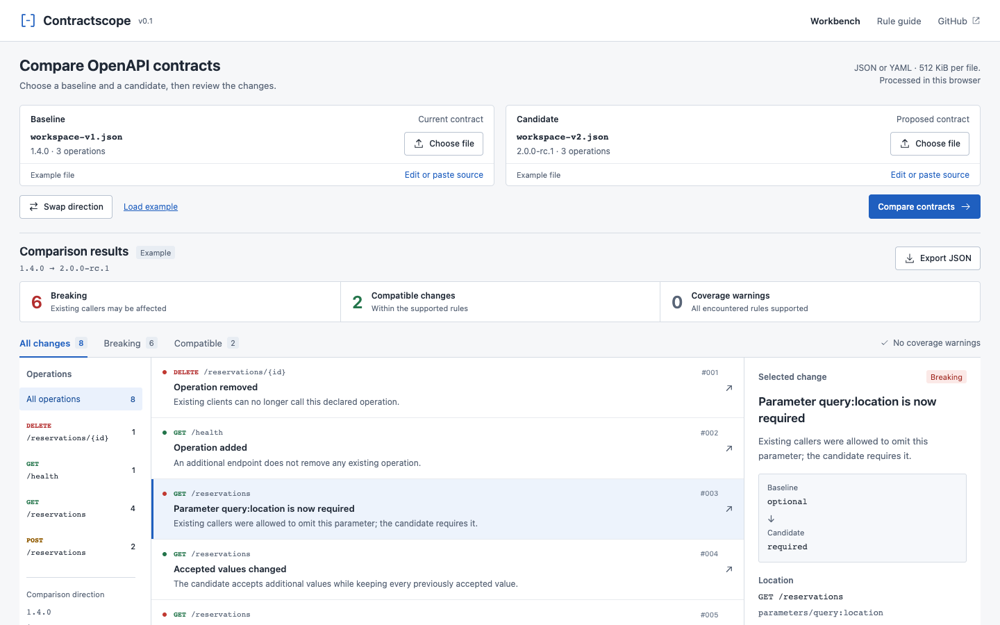

# Contractscope

A browser workbench and Node CLI for reviewing changes between two OpenAPI contracts. Each finding names the affected operation, the comparison rule, and the reason a caller may be affected.

[Open the workbench](https://miiduoa.github.io/contractscope/) · [設計與驗證紀錄](docs/design.zh-TW.md) · [Rule reference](docs/rules.md)



## The problem

A schema diff is easy to read incorrectly. Adding an enum value gives request senders another valid choice, but gives response consumers another case to handle. Making an input required and making an output required have opposite compatibility implications.

Contractscope encodes that direction in a deliberately bounded set of rules. A partial analysis produces **incomplete coverage**, never a clean compatibility verdict.

## Use it locally

Requires Node **22.12 or newer**.

```sh
npm ci
npm run dev
```

Choose or paste a baseline and candidate, then compare. The supplied workspace reservations API is a fictional example, clearly labeled in the interface. Changing either input clears the previous report. Filter by severity or operation, inspect a finding, and export the complete JSON report. Swapping the inputs requires a new comparison: compatibility is directional.

Contract contents are processed in the browser. There is no upload endpoint, account, tracking, or persistence. The interface uses system fonts and makes no external font requests.

## Run it in CI

The CLI and browser call the same TypeScript parser and comparison engine.

```sh
# Human-readable output
npm run diff -- samples/baseline.json samples/candidate.json

# JSON only on stdout, including when the failure policy returns nonzero
npm run --silent diff -- samples/baseline.json samples/candidate.json \
  --json --fail-on-breaking > contract-report.json
```

| Exit | Meaning                                                                                |
| ---- | -------------------------------------------------------------------------------------- |
| `0`  | Complete analysis; no breaking changes, or no breaking-change failure policy requested |
| `1`  | Complete analysis found breaking changes and `--fail-on-breaking` was set              |
| `2`  | Coverage is incomplete, even if breaking changes were also found                       |
| `3`  | Invalid input, unreadable file, or invalid invocation; diagnostic on stderr            |

Reports contain no timestamps or machine paths. The same inputs produce the same ordered JSON. `--json` does not suppress the exit policy. CI should treat **every nonzero exit** as needing attention.

## Scope

- OpenAPI **3.0.x and 3.1.x**, JSON or YAML. Other versions, including 3.2, are rejected.
- Operation additions/removals; effective path and operation parameters; requiredness; request bodies; explicit response statuses; media types.
- Explicit schema types, primitive enums, required properties, closed objects (`additionalProperties: false`), and array items.
- Local JSON Pointer references, with escaped tokens, cycle detection, and an expansion budget. External references are never fetched.
- Input limits: 512 KiB per file, 20,000 parsed nodes, nesting depth 40, 10,000 expanded schema nodes per contract. Duplicate keys and cyclic YAML aliases are rejected.

Open objects, schema composition, bounds/patterns/formats, read/write annotations, security, server configuration, response headers/links, callbacks/webhooks, and unsupported dialects produce coverage warnings. Reference siblings that can affect validation also produce warnings. A missing or unsupported schema cannot silently become a complete report.

The engine is conservative and does not solve arbitrary JSON Schema satisfiability. It checks supported constraints individually; an enum can make a reported type change redundant. Read [the rule reference](docs/rules.md) before applying the result as a policy. This is not a full OpenAPI validator, runtime test, generated-SDK compatibility checker, or release gate on its own.

## Development

```sh
npm test              # Core rules, parser boundaries, references, actual CLI exits
npm run check        # TypeScript
npm run format:check # Source formatting
npm run build        # Typecheck and production bundle
```

`src/core/index.ts` owns parsing, bounded normalization, and comparison. `src/App.tsx` is the workbench; `src/cli/index.ts` handles files and exit codes. Tests launch the actual CLI in separate Node processes, including malformed input and incomplete coverage.

The GitHub Actions workflow checks, tests, builds, and publishes `main` to GitHub Pages. Pull requests run validation without deploying. The Pages build uses `/contractscope/` as its asset base.

MIT licensed.
