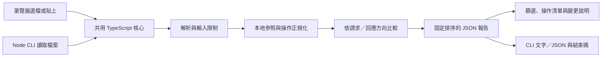

# Contractscope 設計與驗證紀錄

## 要解決的問題

前後端各自改動 API 時，文字 diff 能指出哪一行變了，卻不一定能回答「既有呼叫者會不會受影響」。同一個 `required` 或 `enum` 變更，放在請求與回應中，意義剛好相反。把這些變更全都標紅，會產生過多雜訊；把無法判斷的部分標綠，則會把風險藏起來。

這個作品選擇一個有限、可檢驗的範圍：讀入兩份 OpenAPI 文件，以明確規則逐項比較，並把「已找到的破壞性變更」與「尚未涵蓋的內容」分開呈現。介面以共享空間預約 API 作為可重現的示範資料。

## 資料如何流動

瀏覽器與 CLI 呼叫相同的 `compareContracts`，避免兩套判斷隨功能演進而分歧。核心不依賴瀏覽器或 Node 的檔案 API，CLI 只負責讀檔與程序結束碼，介面只負責輸入、顯示與匯出。

輸入改動後會清除前一份結果；使用者必須重新比較，避免舊成功狀態被誤認成新文件的結果。非同步讀檔使用每個輸入欄位各自的序號，避免較慢的舊讀檔覆蓋較新的貼上內容。檔案內容只在瀏覽器記憶體處理，不上傳、不持久儲存。字型可向 Google Fonts 載入，但不帶入文件內容。

## 為什麼相同改動有相反結果

假設既有 API 的請求允許 `status = confirmed | cancelled`。候選版本再接受 `pending`，舊請求仍然成立，因此是相容的擴充。若這是回應欄位，既有呼叫者可能只有兩種分支；服務開始回傳 `pending`，便增加了舊合約沒有承諾的情況。

同理，請求欄位從可省略變成必填，會拒絕一部分既有請求；回應欄位從可省略變成保證存在，則縮小了可能輸出的集合。程式將方向作為明確參數傳入 schema 比較，測試也以兩個方向成對驗證。

另一個容易被忽略的情況是封閉物件。基準回應若宣告 `additionalProperties: false`，即使候選版本只是增加選填欄位，也超出舊 schema 允許的集合。此版本忠於文件的封閉語意，不默默假設所有 client 都會忽略未知欄位。

## 不確定時如何處理

目前支援 OpenAPI 3.0.x／3.1.x、操作與參數、明確回應狀態、媒體類型、型別、基本值 enum、必填欄位、封閉物件與陣列。開放物件、組合 schema、格式與界限、權限、未知 dialect、外部參照等，皆會產生涵蓋範圍警告。

報告分成兩個維度：`status` 表達已找到的變更；`coverage` 表達是否遇到未涵蓋內容。因此可以同時「已發現破壞性變更」且「分析未完整」，不把警告當成可以忽略的附註。CLI 遇到未完整分析時固定回傳 `2`，即使未開啟 `--fail-on-breaking`，CI 也不會取得成功結束碼。

輸入限制包含每份 512 KiB、解析節點 20,000 個、深度 40 層，以及每份合約 10,000 個展開後 schema 節點。最後一項處理的是小檔案透過重複本地參照造成指數展開的情況；只限制原始檔案大小與循環參照並不足夠。YAML 的數字鍵 `200` 與字串鍵 `"200"` 在轉成物件後可能衝突，也會明確拒絕。

## 驗證紀錄

2026-10-08 執行 `npm test`：**44 個測試通過**。`npm run check` 與 `npm run build` 也通過。涵蓋案例包含：

| 案例                                        | 驗證重點                                   |
| ------------------------------------------- | ------------------------------------------ |
| 請求／回應的 required 與 enum 成對測試      | 方向不會共用錯誤判斷                       |
| integer 與 number、nullable、陣列 item      | 型別集合及巢狀方向                         |
| 刪除最後一個回應內容、刪除替代媒體格式      | 不會把失去承諾的回應格式判為相容           |
| 本地 JSON Pointer、跳脫字元、循環與外部參照 | 可解析與不可解析的界線                     |
| 25 層二元參照展開                           | 節點預算會停止擴張並回報未完整             |
| 重複鍵、YAML alias、過大／過深輸入          | 錯誤有明確出口                             |
| 實際 Node CLI 子程序                        | 0／1／2／3 結束碼、stderr 與固定 JSON 輸出 |

示範合約從 `1.4.0` 比較到 `2.0.0-rc.1`，結果是 **6 個破壞性變更、2 個相容變更、0 個涵蓋範圍警告**。範例原始檔保留在 `samples/`，可由介面或 CLI 重現。

同日以 Chromium 操作正式建置，驗證破壞性變更篩選、JSON 報告下載、JSON 語法錯誤、兩份相同 YAML 的檔案匯入、未支援規則的涵蓋範圍警告，以及交換方向後清除舊結果。修改輸入後，舊報告與匯出按鈕會立即消失。390 px 手機寬度沒有頁面橫向溢出。

獨立檢查找到過一個具體問題：回應媒體類型刪除被當成輸出集合縮小，可能把失去 JSON body 的變更判為相容。修正後改為破壞性變更，並保留「刪除唯一 body」與「仍保留另一種格式」兩個回歸案例。這個修正也凸顯：抽象集合方向必須對照 HTTP 表示法與既有 client 的實際承諾。

## 取捨與下一步

這不是完整 OpenAPI validator，也不是任意 JSON Schema 的等價性證明器。各個已支援限制會獨立比較，可能保守地標出被其他限制抵消的變更。伺服器是否照文件執行、SDK 命名、權限與商業邏輯仍需另外驗證。

下一個值得投入的範圍是開放物件與 `additionalProperties` 的 fallback 語意；必須先定義 request／response 的可包含關係，再補成對案例。另一條路是將報告與 CI 的 PR 檢查整合，但不應以更多介面功能掩蓋尚未明確的比較規則。

規範依據：[OpenAPI 3.1.1](https://spec.openapis.org/oas/v3.1.1.html)。完整規則表見 [rules.md](rules.md)。
